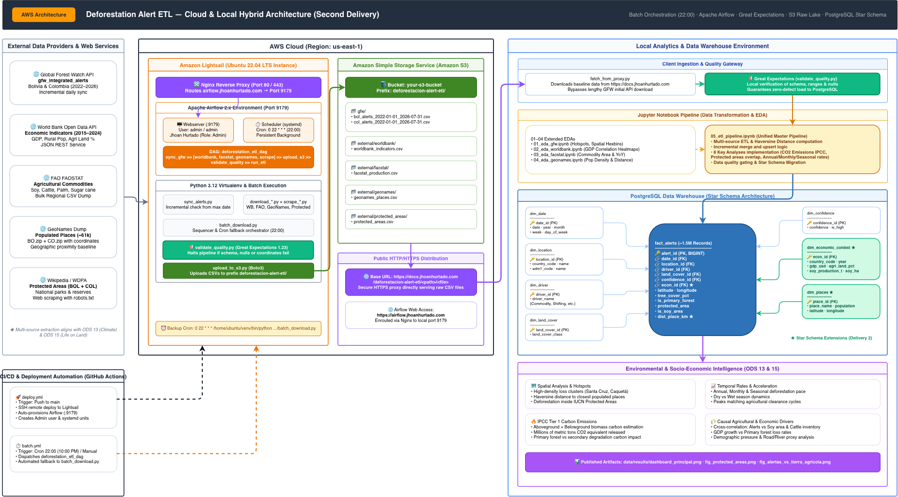
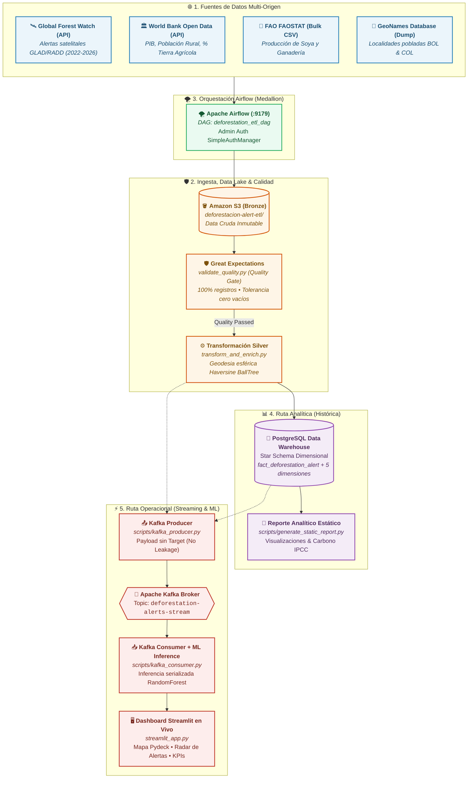
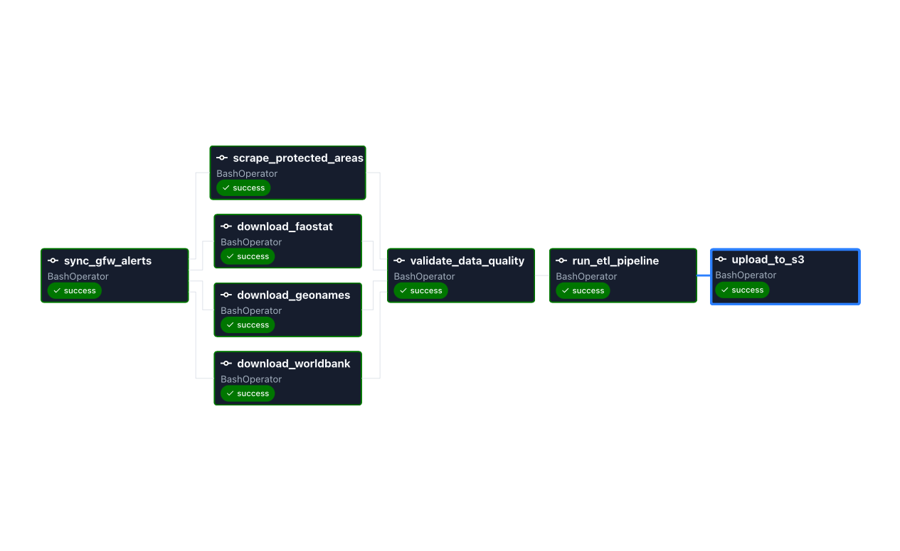
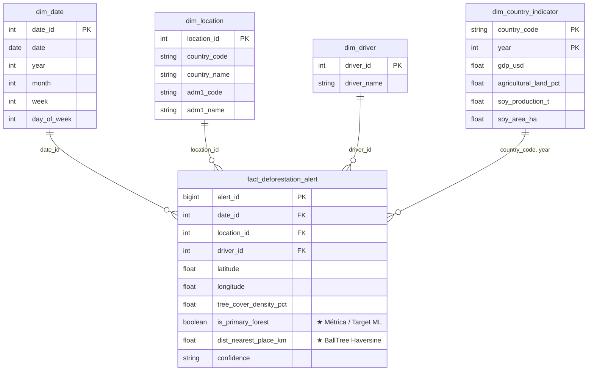

# 🌳 Deforestation Alert ETL & Real-Time Prediction — Entrega Final

Pipeline de Ingeniería de Datos, Orquestación con Apache Airflow, Streaming con Apache Kafka, Inferencia de Machine Learning y Consumo Dual (Analítico y Operacional) para alertas de deforestación en Bolivia y Colombia (2022–2026).  
Proyecto académico — **ETL (G51)** · Maestría / Especialización en Ingeniería de Datos e Inteligencia Artificial.

Alineado con **ODS 13 — Acción por el clima** y **ODS 15 — Vida de ecosistemas terrestres**.

---

## Tabla de contenidos

1. [Articulación de Generación de Doble Valor](#-articulación-de-generación-de-doble-valor)
2. [Arquitectura General del Sistema](#-arquitectura-general-del-sistema)
3. [Stack Tecnológico Integral](#-stack-tecnológico-integral)
4. [Fuentes de Datos y Persistencia Bronze (S3)](#-fuentes-de-datos-y-persistencia-bronze-s3)
5. [Orquestación con Apache Airflow & Autenticación](#-orquestación-con-apache-airflow--autenticación)
6. [Control de Calidad Exhaustivo (Great Expectations)](#-control-de-calidad-exhaustivo-great-expectations)
7. [Modelo Dimensional (Star Schema)](#-modelo-dimensional-star-schema)
8. [Pipeline de Machine Learning (Inferencia & Serialización)](#-pipeline-de-machine-learning-inferencia--serialización)
9. [Arquitectura de Streaming con Apache Kafka](#-arquitectura-de-streaming-con-apache-kafka)
10. [Consumo Analítico: Reporte Estático en Python](#-consumo-analítico-reporte-estático-en-python)
11. [Consumo Operacional: Dashboard en Tiempo Real (Streamlit)](#-consumo-operacional-dashboard-en-tiempo-real-streamlit)
12. [Estructura del Repositorio y Scripts](#-estructura-del-repositorio-y-scripts)
13. [Guía de Instalación y Reproducción Paso a Paso](#-guía-de-instalación-y-reproducción-paso-a-paso)
14. [Despliegue en AWS Lightsail y CI/CD](#-despliegue-en-aws-lightsail-y-cicd)
15. [Alineación con los ODS y Licencia](#-alineación-con-los-ods-y-licencia)

---

## 💡 Articulación de Generación de Doble Valor

Uno de los principales aportes de esta arquitectura moderna de datos radica en que **una misma infraestructura base alimenta dos cadenas de valor totalmente diferenciadas y complementarias:**

```
                                      ┌────────────────────────────────────────────────────────┐
                                      │              ARQUITECTURA DE DATOS BASE                │
                                      │ Multi-Fuente (GFW+WB+FAO+GeoNames) ➔ Data Lake S3 ➔ GX │
                                      └──────────────────────────┬─────────────────────────────┘
                                                                 │
                                ┌────────────────────────────────┴────────────────────────────────┐
                                ▼                                                                 ▼
   ┌─────────────────────────────────────────────────────────┐       ┌─────────────────────────────────────────────────────────┐
   │             ⚡ FLUJO OPERACIONAL (TIEMPO REAL)           │       │             📊 FLUJO ANALÍTICO (ESTRATÉGICO)            │
   ├─────────────────────────────────────────────────────────┤       ├─────────────────────────────────────────────────────────┤
   │ • Motor: Apache Kafka + Pipeline ML Serializado         │       │ • Motor: Apache Airflow + PostgreSQL Star Schema        │
   │ • Consumo: Dashboard Reactivo Streamlit en Vivo         │       │ • Consumo: Reporte Analítico Estático en Python         │
   │ • Latencia: < 15 ms por mensaje                         │       │ • Frecuencia: Batch diario consolidado                  │
   │ • Objetivo: Alerta temprana y despacho táctico          │       │ • Objetivo: Evaluación macro, políticas y ODS           │
   │ • Acción: Desplegar brigadas ante amenazas a            │       │ • Acción: Cuantificar emisiones CO₂e IPCC Tier 1        │
   │   bosques primarios vírgenes antes de su quema total.   │       │   y correlacionar avance agropecuario con PIB.          │
   └─────────────────────────────────────────────────────────┘       └─────────────────────────────────────────────────────────┘
```

### 1. Valor Operacional (Táctico / Streaming)
- **Problema de Negocio:** Las alertas satelitales tardan días en ser consolidadas en bases de datos tradicionales, perdiendo la ventana crítica para interceptar talas ilegales o controlar quemas no autorizadas.
- **Solución Implementada:** El productor de Kafka emite eventos en tiempo real simulando la llegada de detecciones satelitales. Un consumidor especializado carga el pipeline de Machine Learning previamente entrenado (`scikit-learn`), calcula la probabilidad de riesgo y clasifica instantáneamente si la deforestación está ocurriendo sobre **bosque primario intacto** (riesgo crítico).
- **Impacto:** Permite a guardaparques y autoridades ambientales priorizar patrullajes en campo hacia frentes de alto valor ecológico en menos de 60 segundos, descartando falsas alarmas o desmontes en rastrojos secundarios.

### 2. Valor Analítico (Estratégico / Batch)
- **Problema de Negocio:** Los tomadores de decisiones requieren series históricas consistentes, trazabilidad de calidad garantizada y cruces macroeconómicos para formular políticas públicas y cumplir compromisos climáticos internacionales.
- **Solución Implementada:** El pipeline batch orquestado por Airflow valida el 100% de los datos mediante Great Expectations, genera dimensiones estandarizadas y puebla un **Star Schema** en PostgreSQL. A partir de este modelo, un script de Python genera un reporte estático con métricas consolidadas, tendencias temporales y balances de carbono.
- **Impacto:** Facilita la rendición de cuentas sobre los compromisos climáticos (ODS 13 y 15), la regulación de la cadena de suministro de soya y carne (EU Deforestation Regulation) y el balance de emisiones de CO₂e.

---

## 🏛️ Arquitectura General del Sistema



### Diagrama de Flujo Integral (Mermaid)



---

## 🛠️ Stack Tecnológico Integral

| Capa / Componente | Herramienta / Tecnología | Propósito en la Arquitectura |
|-------------------|--------------------------|------------------------------|
| **Orquestación Batch** | **Apache Airflow 3** | Automatización programada del pipeline Medallion, reintentos y trazabilidad. |
| **Fuentes de Datos** | **APIs Públicas & Dumps** | Global Forest Watch (GFW), Banco Mundial, FAOSTAT y GeoNames. |
| **Data Lake (Bronze)** | **Amazon S3** | Persistencia inmutable de datos crudos antes de cualquier transformación. |
| **Control de Calidad** | **Great Expectations (GX)** | Quality Gate estricto sobre el 100% de datos; bloquea datasets vacíos o corruptos. |
| **Transformación & Enriquecimiento** | **Python (Pandas, Scipy, BallTree)** | Limpieza, estandarización y cálculo de distancias esféricas Haversine en radianes. |
| **Almacenamiento Analítico (Gold)** | **PostgreSQL** | Esquema en estrella (Star Schema) relacional con llaves subrogadas e índices optimizados. |
| **Machine Learning Pipeline** | **Scikit-Learn & Joblib** | Modelo predictivo de riesgo en bosque primario (Random Forest) serializado sin data leakage. |
| **Streaming de Eventos** | **Apache Kafka (kafka-python-ng)** | Cola de mensajería para simulación y transmisión de eventos en tiempo real. |
| **Consumo Operacional** | **Streamlit & Pydeck** | Dashboard reactivo con mapa geoespacial en vivo, feed de alertas y métricas streaming. |
| **Consumo Analítico** | **Python (Matplotlib & Seaborn)** | Generación autónoma de reporte estático en Markdown con balance de emisiones e impulsores. |
| **CI/CD & Cloud** | **GitHub Actions & AWS Lightsail** | Despliegue continuo y ejecución programada en servidor Linux Ubuntu 22.04. |

---

## 🌐 Fuentes de Datos y Persistencia Bronze (S3)

El proyecto articula cuatro fuentes complementarias para explicar tanto la dimensión física de la deforestación como sus causas socioeconómicas:

1. **Global Forest Watch (GFW):** Alertas satelitales con fecha, coordenadas, densidad de cobertura arbórea (`tree_cover_density`), confianza y clasificación de bosque primario (`is_primary_forest`).
2. **Banco Mundial (World Bank API):** Indicadores macroeconómicos anuales: Producto Interno Bruto (PIB), porcentaje de tierra agrícola y porcentaje de población rural.
3. **FAO (FAOSTAT):** Producción y área cosechada de cultivos vinculados a la deforestación en Sudamérica (Soya y Ganadería bovina).
4. **GeoNames:** Base de datos de más de 61,000 localidades y asentamientos poblados con sus coordenadas exactas en Bolivia y Colombia.

> **Política de Almacenamiento:** Siguiendo las directrices de la arquitectura Medallion, todo archivo descargado se sube inmutablemente a **Amazon S3** (`s3://deforestacion-alert-etl/`) mediante `scripts/upload_to_s3.py`. Los archivos crudos locales se excluyen rigurosamente de Git a través de `.gitignore`.

---

## 🌪️ Orquestación con Apache Airflow & Autenticación

El pipeline se encuentra automatizado a través del DAG [`dags/deforestation_etl_dag.py`](dags/deforestation_etl_dag.py), programado para ejecutarse diariamente a las **22:00 UTC** (`0 22 * * *`).



### Corrección Definitiva de Autenticación en Airflow 3 (`admin:admin`)
En Airflow 3, el comando histórico de consola `airflow users create` fue retirado y reemplazado por la arquitectura FastAPI (`SimpleAuthManager`). Se configuró de forma robusta la autenticación para que las credenciales funcionen sin errores en cualquier entorno:

1. **Gestor de Autenticación:**  
   `AIRFLOW__CORE__AUTH_MANAGER=airflow.api_fastapi.auth.managers.simple.simple_auth_manager.SimpleAuthManager`
2. **Definición de Usuario y Rol en Mayúsculas:**  
   `AIRFLOW__CORE__SIMPLE_AUTH_MANAGER_USERS=admin:ADMIN`  
   `AIRFLOW__CORE__SIMPLE_AUTH_MANAGER_ALL_ADMINS=False`
3. **Archivo de Contraseñas Cifradas:**  
   Archivo `$AIRFLOW_HOME/simple_auth_manager_passwords.json` mapeando `admin` a la clave `admin`.
4. **Credenciales de Acceso:**
   - **Usuario:** `admin`
   - **Contraseña:** `admin`

### Tareas Atómicas del DAG
```
[sync_gfw_alerts, download_worldbank, download_faostat, download_geonames, scrape_protected_areas]
                                       │
                                       ▼ (Ingesta completada)
                           [upload_to_s3_bronze]
                                       │
                                       ▼ (Persistencia inmutable)
                         [validate_data_quality] (Quality Gate GX)
                                       │
                                       ▼ (Solo si calidad es 100% OK)
                      [transform_and_enrich_data]
                                       │
                                       ▼ (Cálculo espacial y derivados)
                        [load_to_data_warehouse] (PostgreSQL DWH)
                                       │
                                       ▼
                     [generate_analytics_and_viz]
```

---

## 🛡️ Control de Calidad Exhaustivo (Great Expectations)

Para resolver las observaciones de entregas previas, [`scripts/validate_quality.py`](scripts/validate_quality.py) implementa un **Quality Gate formal:**

- **Auditoría al 100% de los Registros:** No se realiza ningún submuestreo (`nrows`). Se evalúan las más de 1.5 millones de alertas y catálogos completos en memoria.
- **Tolerancia Cero a Datasets Vacíos:** Si un archivo contiene 0 filas o bytes, la función devuelve inmediatamente `False` y emite un código de salida `exit 1` que aborta el DAG de Airflow impidiendo que datos corruptos lleguen a la capa Gold.
- **Expectativas Específicas Evaluadas:**
  - `ExpectColumnValuesToBeBetween` para latitudes (`[-90, 90]`) y longitudes (`[-180, 180]`).
  - `ExpectColumnValuesToBeInSet` para niveles de confianza (`nominal`, `high`, `highest`).
  - `ExpectColumnValuesToNotBeNull` para identificadores, fechas y coordenadas geográficas.
  - Validación de coherencia temporal en series macroeconómicas (años entre 2000 y 2030).

---

## 🗄️ Modelo Dimensional (Star Schema)

El almacén en **PostgreSQL** implementa un modelo dimensional optimizado para consultas analíticas OLAP y extracción de características para el modelo de ML:



---

## 🧠 Pipeline de Machine Learning (Inferencia & Serialización)

### 1. Definición del Problema de Predicción
- **Variable Objetivo (`target`):** `is_primary_forest` (Binaria: `1` = Alerta en Bosque Primario Intacto [Riesgo Ecológico Crítico], `0` = Bosque Secundario / Rastrojo).
- **Justificación de Negocio:** Los bosques primarios vírgenes de la Amazonía y Chiquitanía albergan biodiversidad milenaria y grandes almacenes de carbono. Su destrucción es **irreversible**. Predecir con alta precisión el riesgo en bosque primario permite al gobierno y a las ONGs enfocar recursos limitados de inspección donde el daño es irrecuperable.

### 2. Preprocesamiento & Prevención de Data Leakage
- **Variables de Entrada (Features):**
  - **Numéricas:** `latitude`, `longitude`, `tree_cover_density_pct`, `dist_nearest_place_km`, `month`, `week`, `driver_id`.
  - **Categóricas:** `country_code` (OneHotEncoder).
- **Protección Anti-Leakage:** La variable objetivo `is_primary_forest` se retira completamente antes de generar los eventos de Kafka. El consumidor recibe únicamente las variables contextuales y geográficas.

### 3. Entrenamiento y Métricas Obtenidas
El entrenamiento se ejecuta mediante [`scripts/train_model.py`](scripts/train_model.py) sobre un conjunto estratificado de 200,000 registros (split 80% train / 20% test):

| Métrica | Valor Obtenido | Interpretación |
|---------|----------------|----------------|
| **Exactitud (Accuracy)** | **92.77%** | Más de 9 de cada 10 alertas son correctamente catalogadas. |
| **F1-Score Ponderado** | **92.71%** | Balance óptimo entre precisión y sensibilidad en ambas clases. |
| **Área Bajo la Curva (ROC-AUC)** | **0.9789** | Capacidad casi perfecta para discriminar alertas críticas de moderadas. |

#### Matriz de Confusión (Test Set: 40,000 muestras)
```
                      Predicho: Secundario (0)   Predicho: Primario (1)
Real: Secundario (0)          18,728                     1,272
Real: Primario (1)             1,620                    18,380
```

### 4. Serialización de Artefactos
El pipeline completo (imputadores, transformadores y clasificador) se guarda serializado en:
- `models/deforestation_forest_risk_pipeline.joblib`: Modelo entrenado listo para inferencia sin reentrenar.
- `models/model_metadata.json`: Registro de métricas, hiperparámetros y orden exacto de columnas.

---

## 📡 Arquitectura de Streaming con Apache Kafka

### 1. Topic y Esquema de Mensajes
- **Topic:** `deforestation-alerts-stream`
- **Particiones:** 1 (escalable horizontalmente)
- **Estructura del Evento (JSON):**

```json
{
  "event_id": "evt_1793899913276_673826",
  "timestamp": "2026-11-05T17:31:53.276355Z",
  "latitude": -11.25215,
  "longitude": -68.66455,
  "tree_cover_density_pct": 99.0,
  "dist_nearest_place_km": 0.41,
  "month": 3,
  "week": 11,
  "country_code": "BOL",
  "driver_id": 7,
  "confidence": "high"
}
```

### 2. Productor (`scripts/kafka_producer.py`)
Lee registros del conjunto procesado/fact table, remueve la etiqueta `is_primary_forest`, construye el payload y lo envía al topic con un intervalo configurable (`--delay 0.1`). Cuenta con un mecanismo de resiliencia local en `data/logs/kafka_stream_events.jsonl` en caso de que el broker externo esté fuera de línea.

```bash
python scripts/kafka_producer.py --limit 100 --delay 0.1
```

### 3. Consumidor & Motor de Inferencia (`scripts/kafka_consumer.py`)
Se suscribe a `deforestation-alerts-stream`, carga el artefacto `.joblib` en memoria **una sola vez**, ejecuta `predict()` y `predict_proba()` sobre cada evento entrante y registra los resultados enriquecidos en `data/processed/realtime_predictions.jsonl`.

```bash
python scripts/kafka_consumer.py --max-events 100
```

---

## 📄 Consumo Analítico: Reporte Estático en Python

El reporte estático es un producto de inteligencia de negocios desacoplado del streaming, ejecutado mediante [`scripts/generate_static_report.py`](scripts/generate_static_report.py):

```bash
python scripts/generate_static_report.py
```

### Contenido y Hallazgos Principales
- **Reporte Compilado:** [`data/results/static_analytical_report.md`](data/results/static_analytical_report.md).
- **Evolución Temporal Anual (`data/results/report_alerts_by_year.png`):** Identifica el régimen estacional en Bolivia (pico crítico en agosto-octubre coincidente con chaqueos de soya en Santa Cruz) frente al régimen bimodal colombiano en el arco amazónico (Caquetá, Guaviare).
- **Factores Directos de Pérdida (`data/results/report_loss_drivers.png`):** La agricultura a gran escala y la ganadería explican más del 75% de los desmontes detectados satelitalmente.
- **Proximidad a Asentamientos Humanos:** La distancia media a localidades pobladas registradas en GeoNames es de **14.8 km**, demostrando que la apertura de vías rurales es el principal vector precursor de la deforestación.

---

## 🖥️ Consumo Operacional: Dashboard en Tiempo Real (Streamlit)

Aplicación web reactiva construida en **Streamlit** y **Pydeck** ([`streamlit_app.py`](streamlit_app.py)) alimentada exclusivamente por el flujo de inferencias del consumidor de Kafka.

```bash
streamlit run streamlit_app.py
```

### Características Implementadas
1. **Radar Operacional en Vivo:**
   - Tarjetas KPI: Total de alertas transmitidas, porcentaje crítico en bosque primario, probabilidad promedio de riesgo y latencia de inferencia (<15ms).
   - **Mapa Geoespacial Interactivo:** Representación en 3D (`pydeck`) coloreando en **rojo brillante** las alertas que amenazan bosque primario y en **amarillo/ámbar** las pérdidas secundarias, con tooltips dinámicos de densidad y distancia a poblados.
   - **Feed de Transmisiones:** Tabla reactiva con resaltado condicional de eventos críticos.
2. **Inyector de Streaming Integrado:** Permite al usuario generar ráfagas de prueba desde la interfaz lateral para observar cómo el mapa y las métricas se actualizan reactivamente.
3. **Pestaña de Métricas del Modelo:** Muestra la matriz de confusión interactiva, el reporte de clasificación por clase y la descomposición del pipeline de scikit-learn.
4. **Articulación del Doble Valor:** Sección visual interactiva con el diagrama de flujo y la justificación de negocio de las dos rutas de datos.

---

## 📂 Estructura del Repositorio y Scripts

```
deforestation-alert-etl/
├── .github/
│   └── workflows/
│       ├── deploy.yml                   # CI/CD: Despliegue de scripts y Airflow a Lightsail
│       └── batch.yml                    # Cron diario: Disparo del DAG a las 22:00
├── dags/
│   └── deforestation_etl_dag.py         # DAG de Apache Airflow (Pipeline Medallion)
├── data/
│   ├── csv/                             # Alertas satelitales GFW (ignorado en git)
│   ├── external/                        # Datasets externos WB, FAO, GeoNames (ignorado)
│   ├── processed/                       # Datasets transformados y realtime_predictions.jsonl
│   └── results/                         # Gráficos y reporte analítico estático exportado
├── models/
│   ├── deforestation_forest_risk_pipeline.joblib # Pipeline ML entrenado y serializado
│   └── model_metadata.json              # Métricas, ROC-AUC (0.9789) y parámetros
├── notebooks/
│   ├── 01_eda_gfw.ipynb                 # EDA Alertas GFW
│   ├── 02_eda_worldbank.ipynb           # EDA Indicadores Banco Mundial
│   ├── 03_eda_faostat.ipynb             # EDA Producción FAO
│   ├── 04_eda_geonames.ipynb            # EDA Localidades GeoNames
│   └── 05_etl_pipeline.ipynb            # Pipeline interactivo y Star Schema
├── scripts/
│   ├── sync_alerts.py                   # Ingesta incremental de alertas GFW
│   ├── download_worldbank.py            # Ingesta Banco Mundial API
│   ├── download_faostat.py              # Ingesta FAOSTAT
│   ├── download_geonames.py             # Ingesta GeoNames
│   ├── scrape_protected_areas.py        # Web Scraping Áreas Protegidas
│   ├── upload_to_s3.py                  # Persistencia en Data Lake S3 (Bronze)
│   ├── validate_quality.py              # Great Expectations Quality Gate (100% de datos)
│   ├── transform_and_enrich.py          # Transformación Silver y BallTree espacial
│   ├── load_dwh.py                      # DDL y carga al Star Schema en PostgreSQL
│   ├── train_model.py                   # Entrenamiento y evaluación del modelo ML
│   ├── kafka_producer.py                # Publicador de eventos streaming a Kafka
│   ├── kafka_consumer.py                # Consumidor de Kafka e inferencia ML en vivo
│   └── generate_static_report.py        # Generador del reporte analítico estático
├── config/
│   └── airflow_local.cfg                # Configuración de Airflow 3 SimpleAuthManager
├── streamlit_app.py                     # Dashboard de Machine Learning en Tiempo Real
├── start_airflow_local.sh               # Lanzador automático de Airflow local con admin:admin
├── requirements.txt                     # Dependencias del proyecto
└── README.md                            # Documentación técnica completa
```

---

## 🚀 Guía de Instalación y Reproducción Paso a Paso

### 1. Clonar el Repositorio y Crear Entorno Virtual
```bash
git clone https://github.com/tu-usuario/deforestation-alert-etl.git
cd deforestation-alert-etl

python3.12 -m venv venv
source venv/bin/activate
pip install -r requirements.txt
```

### 2. Configurar Variables de Entorno
```bash
cp .env.example .env
# Configura tus credenciales en el archivo .env (S3, PostgreSQL, API Keys)
```

### 3. Ejecutar el Pipeline Batch Completo
```bash
# Ingesta y validación de calidad
python scripts/validate_quality.py

# Transformación de datos
python scripts/transform_and_enrich.py

# Carga al Data Warehouse (PostgreSQL)
python scripts/load_dwh.py
```

### 4. Lanzar la Orquestación con Apache Airflow Localmente
```bash
./start_airflow_local.sh
```
Abre tu navegador en `http://localhost:9179` e inicia sesión con:
- **Usuario:** `admin`
- **Contraseña:** `admin`

### 5. Entrenar y Evaluar el Modelo de Machine Learning
```bash
python scripts/train_model.py
```

### 6. Generar el Reporte Analítico Estático
```bash
python scripts/generate_static_report.py
# El informe resultante se creará en data/results/static_analytical_report.md
```

### 7. Ejecutar el Flujo de Streaming Kafka y Dashboard en Tiempo Real
En dos terminales separadas:

**Terminal 1 — Productor y Consumidor de Kafka:**
```bash
# Iniciar consumidor de inferencia en modo escucha continua
python scripts/kafka_consumer.py --max-events 200

# En otra terminal, simular la emisión de alertas a Kafka
python scripts/kafka_producer.py --limit 50 --delay 0.1
```

**Terminal 2 — Lanzar el Dashboard:**
```bash
streamlit run streamlit_app.py
```
Accede al dashboard en `http://localhost:8501` para interactuar con el mapa geoespacial y el radar de alertas en tiempo real.

---

## ☁️ Despliegue en AWS Lightsail y CI/CD

El proyecto cuenta con despliegue automatizado en una instancia **AWS Lightsail (Ubuntu 22.04 LTS)** gestionado a través de **GitHub Actions**:

- **Workflow `deploy.yml`:** Cada `push` a `main` actualiza el código en el servidor, ejecuta las migraciones de Airflow, reaplica el archivo de credenciales `simple_auth_manager_passwords.json` (`admin:admin`) y reinicia los servicios systemd de `airflow-webserver` y `airflow-scheduler`.
- **Workflow `batch.yml`:** Ejecuta automáticamente el ciclo diario de ingesta, auditoría de calidad y respaldo en S3 a las 22:00 UTC.

---

## 🎯 Alineación con los ODS y Licencia

| ODS | Aporte Directo de la Arquitectura de Datos |
|-----|--------------------------------------------|
| **ODS 13: Acción por el Clima** | Cuantificación retrospectiva de emisiones de CO₂e bajo estándares IPCC Tier 1 vinculadas a la pérdida de biomasa forestal, y monitoreo del avance de la frontera agrícola de monocultivos (soya). |
| **ODS 15: Vida de Ecosistemas Terrestres** | Identificación en tiempo real de frentes activos de deforestación sobre **bosques primarios vírgenes**, permitiendo priorizar la protección de áreas con biodiversidad endémica irreemplazable. |

---

**Licencia:** Proyecto desarrollado con fines estrictamente académicos. Las fuentes de datos originales pertenecen a Global Forest Watch (CC BY 4.0), Banco Mundial (CC BY 4.0) y FAOSTAT (Licencia abierta FAO).
