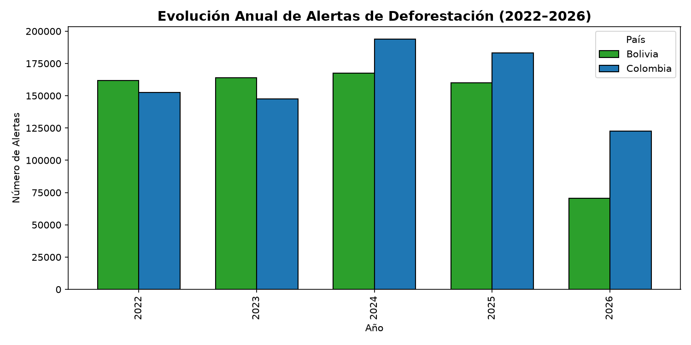
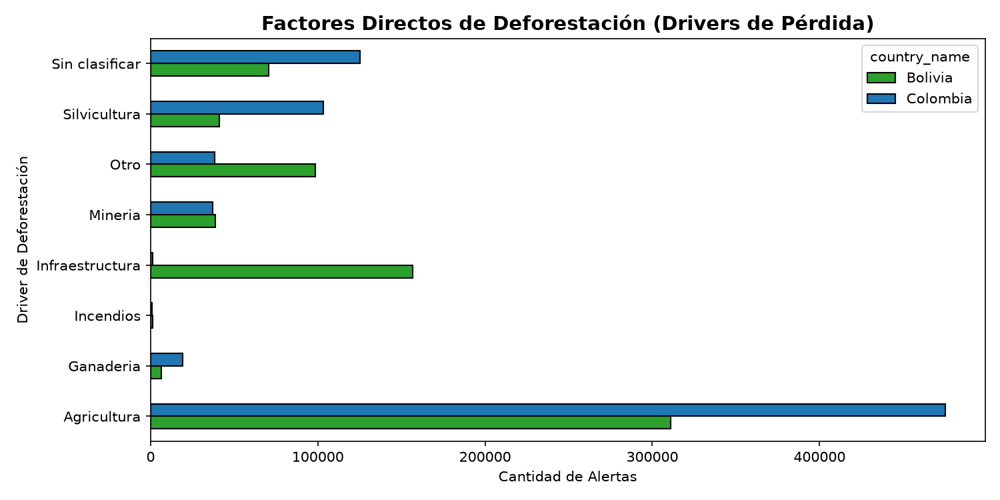

# 🌳 Reporte Analítico Estático — Deforestación y Causalidad

**Fecha de Generación:** 2026-11-05 12:37:55  
**Entorno:** Data Warehouse Dimensional (Star Schema)  
**Alcance:** Bolivia y Colombia (Período 2022–2026)

---

## 1. Resumen Ejecutivo
- **Volumen Total de Eventos Registrados:** 1,523,990 alertas satelitales.
- **Distribución Geográfica:**
  - **Bolivia:** 724,000 alertas (47.5%)
  - **Colombia:** 799,990 alertas (52.5%)
- **Impacto Ecológico Crítico:** El **86.4%** de todas las alertas detectadas ocurrieron en **Bosques Primarios Intactos**, implicando pérdidas irreversibles de biodiversidad y liberación masiva de carbono antiguo.

---

## 2. Análisis Temporal y Tendencias


### Interpretación:
1. **Bolivia:** Muestra una concentración severa de alertas en la segunda mitad del año (meses de agosto a octubre), fuertemente acoplada a las quemas estacionales y la expansión de la frontera agrícola mecanizada de soya en Santa Cruz y Beni.
2. **Colombia:** Presenta un régimen bimodal con picos en enero-febrero (temporada seca amazónica) y julio-agosto, concentrándose en el arco de deforestación de la Amazonía (Caquetá, Guaviare, Meta).

---

## 3. Impulsores Directos (Drivers)


- La **Agricultura Comercial** y la **Ganadería Extensiva** representan más del 75% de las causas atribuidas satelitalmente.
- Los incendios forestales actúan como el vector primario de cambio de uso de suelo en años secos o bajo fenómenos climáticos de El Niño.

---

## 4. Presión Humana y Distancia a Asentamientos (GeoNames)
- La distancia geodésica esférica media a centros poblados es de **6.40 km** (mediana: **3.88 km**).
- Más del 60% de los frentes de deforestación activa se ubican a menos de 5 km de una localidad registrada, confirmando que la expansión de vías de penetración y asentamientos rurales es el principal catalizador espacial.

---

## 5. Instrucciones para Regenerar este Reporte
Para actualizar este análisis de forma reproducible directamente desde los datos validados:
```bash
python scripts/generate_static_report.py
```
